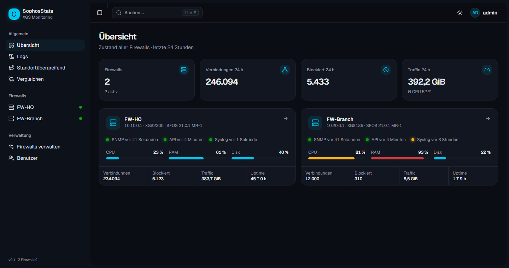
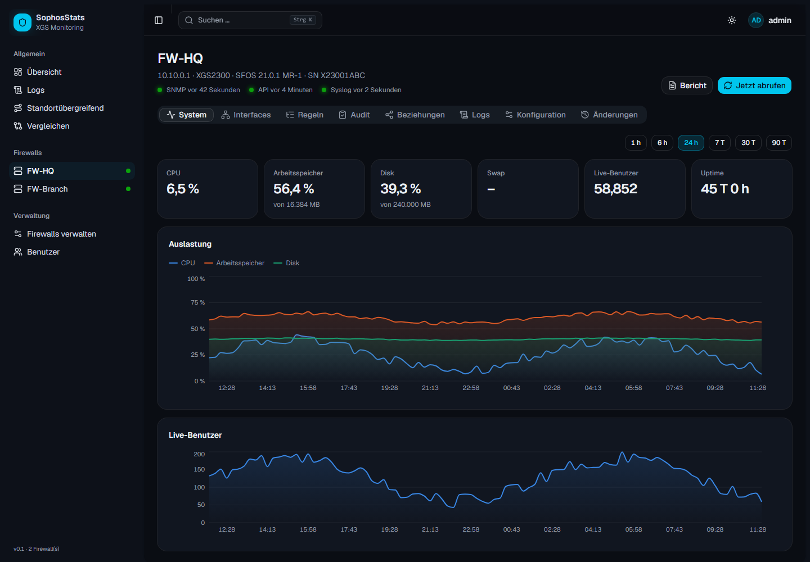
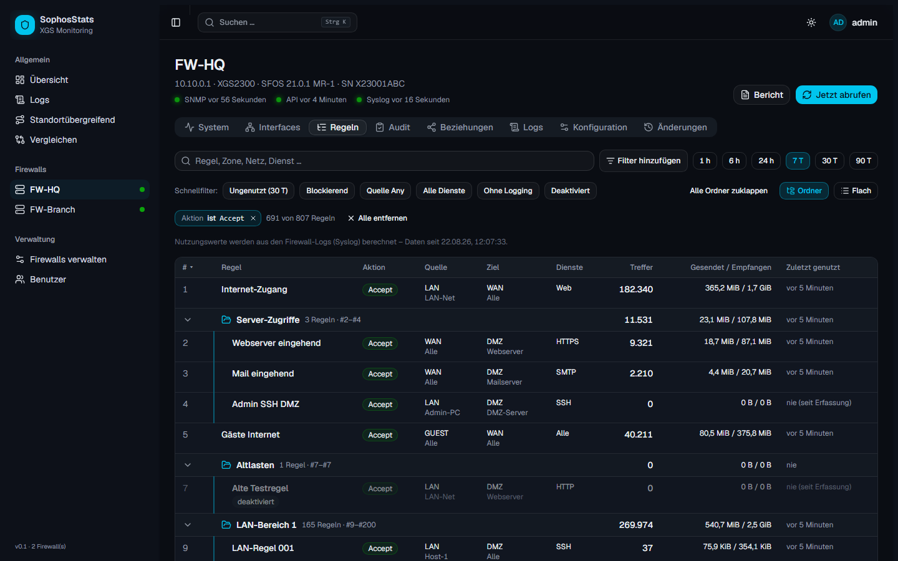
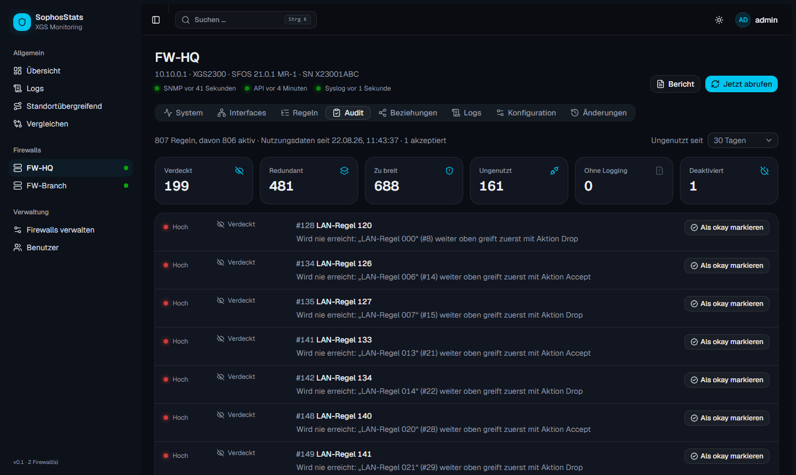
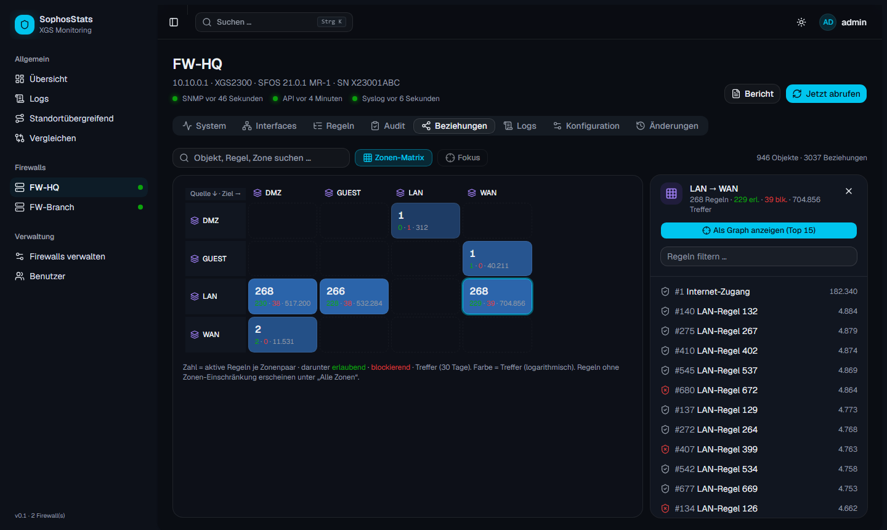
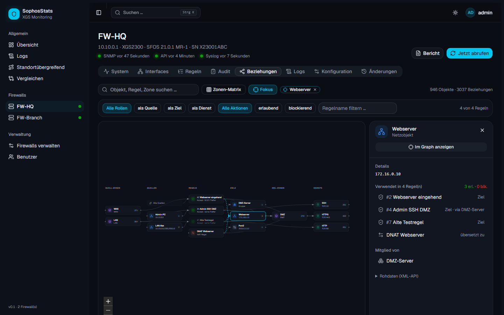
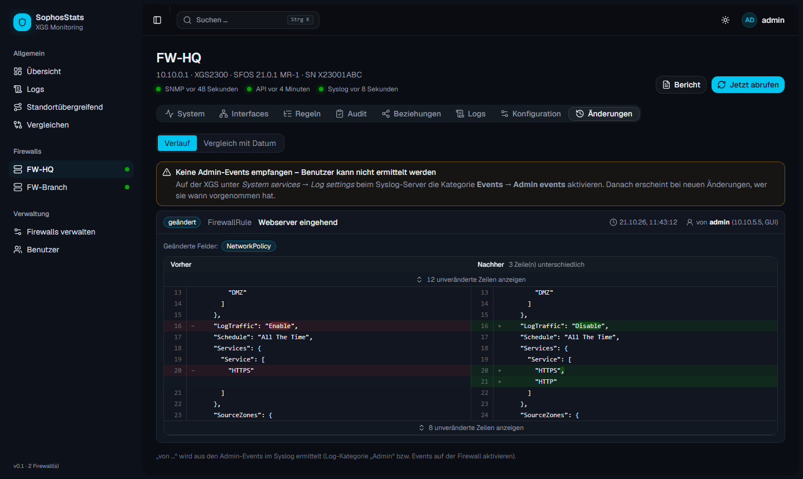
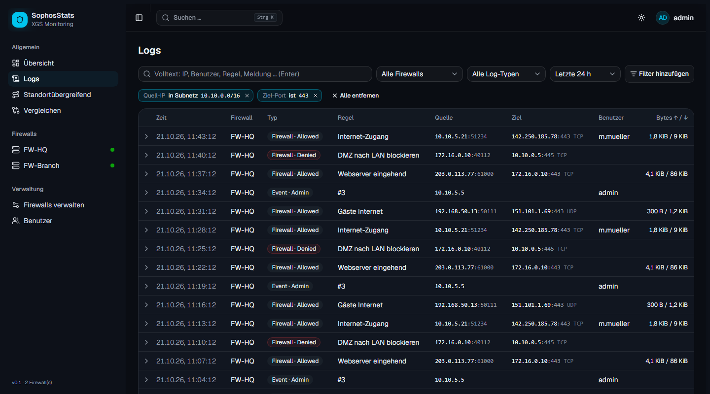
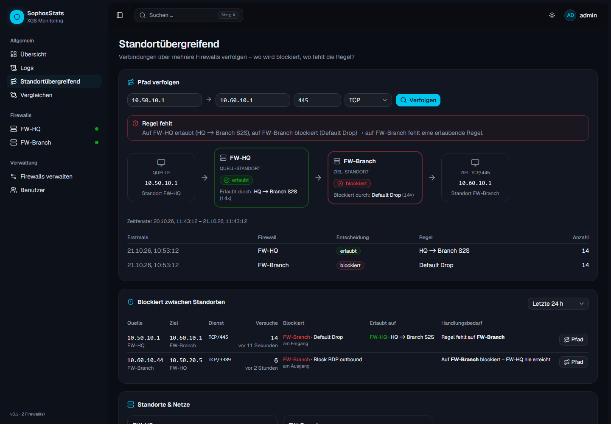
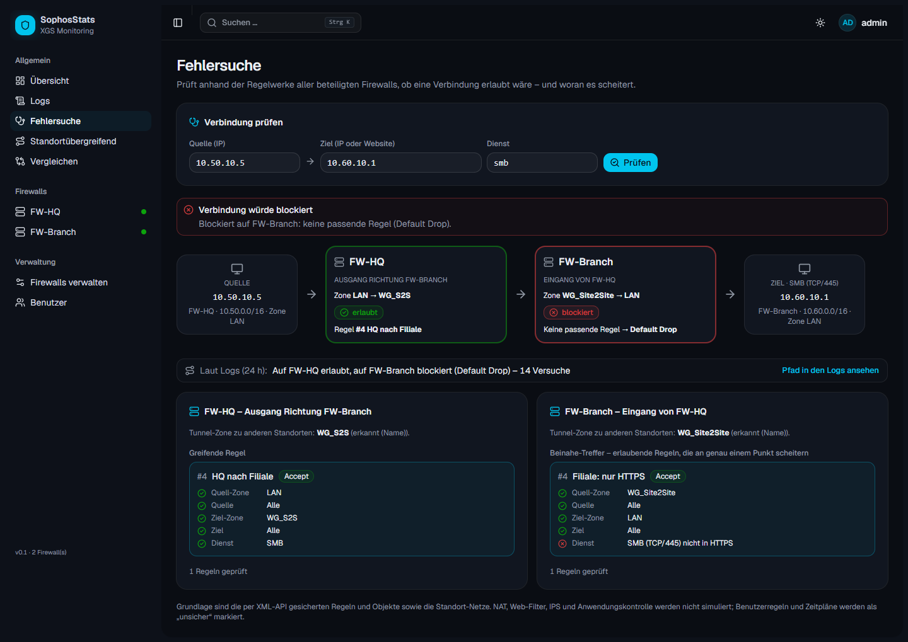

<div align="center">

# SophosStats

**Monitoring, Regel-Analyse und Compliance für Sophos-XGS-Firewalls (SFOS).**

SNMP v3 · XML-API · Syslog · Docker · Python/FastAPI · React/shadcn/ui



</div>

SophosStats sammelt im Hintergrund Systemwerte, Konfiguration und Logs mehrerer Sophos-XGS-Firewalls und
macht sie in einer modernen Weboberfläche auswertbar. Dazu gehören Auslastung, Regelnutzung, Regel-Audit,
Konfigurationsänderungen mit Verursacher, Beziehungen zwischen Objekten und Regeln sowie die Verfolgung
blockierter Verbindungen über mehrere Standorte.

---

## Inhalt

- [Funktionen](#funktionen)
- [Screenshots](#screenshots)
- [Wie es funktioniert](#wie-es-funktioniert)
- [Schnellstart (Docker Compose)](#schnellstart-docker-compose)
- [Deployment mit Portainer](#deployment-mit-portainer)
- [Konfiguration](#konfiguration)
- [Einrichtung auf der Sophos XGS](#einrichtung-auf-der-sophos-xgs)
- [Sicherheit](#sicherheit)
- [Betrieb: Updates, Backup, Datenhaltung](#betrieb-updates-backup-datenhaltung)
- [Fehlerbehebung](#fehlerbehebung)
- [Entwicklung](#entwicklung)
- [Bekannte Grenzen](#bekannte-grenzen)

---

## Funktionen

**Monitoring**
- CPU, RAM, Disk, Swap, Uptime und Live-User per SNMP v3, als Verlauf von 1 Stunde bis 90 Tage
- Durchsatz und Link-Status aller Interfaces
- Übersicht über alle Firewalls mit Status der Datenquellen (SNMP, API, Syslog)

**Regeln**
- Alle Firewall-Regeln mit **Treffern, Bytes gesendet/empfangen und „zuletzt genutzt“**, berechnet aus den Logs
- Regelgruppen als **aufklappbare Ordner** wie in der Sophos-Oberfläche (mit Summen je Ordner) oder als flache Liste, die Wahl wird pro Nutzer gemerkt
- Kombinierbare Filter (Zonen, Netze, Dienste, „Any“, Aktion, Logging, Treffer, Alter) und Schnellfilter
- Pro Regel: Verlauf, Top-Quellen/-Ziele/-Ports und ein **Nutzungsprofil**, das zeigt, was die Regel tatsächlich durchlässt

**Regel-Audit**
- Findet verdeckte und redundante Regeln, zu breite Regeln (Any als Quelle, Ziel oder Dienst, gestuft nach Schwere), ungenutzte, ungeloggte und deaktivierte Regeln
- Befunde lassen sich **mit Begründung als okay markieren**. Die Akzeptanz verfällt automatisch, wenn die Regel geändert wird oder die Frist abläuft.

**Beziehungen**
- **Zonen-Matrix**: Quell- × Ziel-Zone mit Anzahl der Regeln und Treffern, auch bei tausenden Regeln übersichtlich
- **Fokus-Graph**: Zu einem Objekt (Host, Gruppe, Dienst, Zone, Regel) siehst du alle Regeln, die darauf verweisen, auch indirekt über Gruppen

**Änderungen und Compliance**
- Jeder Konfigurationsabruf wird mit dem vorherigen verglichen. Hinzugefügte, geänderte und entfernte Objekte landen in einer Historie.
- **Side-by-Side-Diff** mit Hervorhebung der geänderten Werte
- **Wer und wann**: Zuordnung der Änderungen zu den Admin-Events aus dem Syslog
- Konfiguration „Stand am Datum X“, Vergleich mit heute, Vergleich zweier Firewalls
- **Druckbarer Bericht** für einen Zeitraum, als PDF über den Browser, inklusive akzeptierter Hinweise

**Hostnamen**
- Die IPs aus den Logs werden im Hintergrund per **Reverse-DNS** in Hostnamen übersetzt (gedrosselt, mit Cache,
  standardmäßig nur interne IPs); zusätzlich zählen die Host-Objekte der Firewalls als Namen
- Suchfelder schlagen beim Tippen bekannte Hosts vor (`EDV-` → alle Hosts mit diesem Anfang, `10.50.` → alle Hosts
  im Bereich); ein eingegebener Hostname wird automatisch in seine IP aufgelöst
- Unter jeder IP in den Logs steht der bekannte Hostname

**Logs**
- Alle Logs per Syslog, mit Volltextsuche und **kombinierbaren Filtern**: Subnetz (CIDR), Ports, beliebige Rohfelder
- Klick auf einen Wert filtert danach, Strg+Klick schließt ihn aus. Die Suche steht in der URL und lässt sich teilen.

**Fehlersuche**
- Quelle, Ziel (IP oder Website) und Dienst eingeben: SophosStats ermittelt Standort und Zone von Quelle und Ziel,
  die Firewalls auf dem Weg und **simuliert deren Regelwerke** – erste passende Regel, sonst Default Drop
- Zeigt je Firewall die greifende Regel mit Haken pro Kriterium und **Beinahe-Treffer** („Regel #20 passt bis auf
  den Dienst“), dazu den Abgleich mit den Logs der letzten 24 h
- Nur Ziel eingeben („Wer erreicht 10.60.10.1?“): listet auf allen Firewalls die Regeln, die dieses Ziel enthalten,
  mit Quell-Zonen, Quell-Netzen und Diensten – optional auf einen Dienst eingeschränkt
- Nur Quelle eingeben („Was wird für 10.50.10.5 blockiert?“): wertet die Logs aller Module aus – Firewall-Regeln,
  Web-Filter, Anwendungskontrolle, IPS, ATP, Virenschutz – gruppiert nach Ziel bzw. Grund, mit Sprung zur Regelprüfung

**Standortübergreifend**
- Verfolgt eine Verbindung über mehrere Firewalls, z. B. Standort A → WireGuard → Standort B, und zeigt: *„Auf FW-A erlaubt, auf FW-B blockiert → Regel fehlt auf FW-B“*
- Übersicht aller blockierten Verbindungen zwischen Standorten mit Handlungsbedarf

**Bedienung**
- Login mit **2FA (TOTP)**, Rollen Administrator und Betrachter
- Dunkles und helles Design, Suche über **Strg+K**, alle Ansichten per URL verlinkbar

---

## Screenshots

| | |
|---|---|
| **System**: Auslastung und Verlauf<br> | **Regeln**: Ordner, Nutzung und kombinierbare Filter<br> |
| **Audit**: Befunde mit Akzeptanz<br> | **Zonen-Matrix**: Regeln je Zonenpaar<br> |
| **Beziehungen**: alle Regeln zu einem Objekt<br> | **Änderungen**: Diff mit Verursacher<br> |
| **Logs**: Filter per Klick und CIDR<br> | **Standortübergreifend**: wo fehlt die Regel?<br> |
| **Fehlersuche**: Regelwerke über alle Firewalls simulieren<br> | |

*Die Screenshots zeigen Beispieldaten.*

---

## Wie es funktioniert

```
                ┌──────────────────────── Docker Compose ─────────────────────────┐
 Browser ──────►│ web (nginx, TLS) ───► api (FastAPI) ──┐                          │
                │                                         ├──► db (PostgreSQL +     │
 Sophos XGS ◄───│ collector ── SNMP v3 / XML-API ─────────┤        TimescaleDB)       │
 Sophos XGS ───►│ collector ◄─ Syslog UDP/TCP 5514 ───────┘                          │
                └──────────────────────────────────────────────────────────────────┘
```

| Daten | Quelle | Standard-Intervall |
|---|---|---|
| CPU, RAM, Disk, Swap, Uptime, Live-User, Modell, Firmware | SNMP v3 (SFOS-MIB, HOST-RESOURCES-MIB) | 60 s |
| Interface-Durchsatz und -Status | SNMP v3 (IF-MIB, 64-Bit-Zähler) | 60 s |
| Regeln, NAT, Objekte, Zonen, Interfaces, VPN, Routen | XML-API | 15 min |
| Konfigurationsänderungen | Vergleich der XML-API-Abrufe | mit jedem Abruf |
| Logs, Regelnutzung, Admin-Events | Syslog | laufend |

> **Warum drei Quellen?** Die SFOS-XML-API liefert nur Konfiguration, keine Zähler. Live-Werte kommen
> deshalb per SNMP, die Regelnutzung wird aus den Firewall-Logs berechnet.

| Komponente | Technik |
|---|---|
| Backend | Python 3.13, FastAPI, SQLAlchemy 2.1 (async), Pydantic v2, pysnmp 7, httpx |
| Frontend | React 19, TypeScript, Vite, TanStack Query, shadcn/ui (Radix), Tailwind CSS 4, Recharts, React Flow |
| Datenbank | PostgreSQL 17 mit TimescaleDB (Hypertables, Aufbewahrung, Kompression) |
| Auslieferung | nginx mit TLS, Docker Compose |

---

## Schnellstart (Docker Compose)

**Voraussetzungen:** Linux-Server oder VM mit Docker und Docker Compose, Netzwerkzugriff auf die Firewalls.

```bash
git clone https://github.com/bluecraank/SophosStats.git
cd SophosStats
cp .env.example .env
```

Schlüssel erzeugen und in die `.env` eintragen:

```bash
docker run --rm python:3.13-slim sh -c \
  "pip -q install cryptography && python -c 'from cryptography.fernet import Fernet; print(Fernet.generate_key().decode())'"
```

Pflichtwerte in der `.env`: `POSTGRES_PASSWORD`, `ENCRYPTION_KEY` und `INITIAL_ADMIN_PASSWORD` (mindestens 12 Zeichen).

```bash
docker compose up -d --build
```

Danach `https://<server>` öffnen und mit `admin` und dem Passwort aus der `.env` anmelden. Unter **Konto**
solltest du direkt 2FA einrichten.

> Ohne eigenes Zertifikat erzeugt der Web-Container beim ersten Start ein selbstsigniertes. Ein eigenes
> Zertifikat legst du als `tls.crt` und `tls.key` in das Volume `certs` und startest den Container neu.

**Ports**

| Port | Zweck |
|---|---|
| 443/tcp (`HTTPS_PORT`) | Weboberfläche |
| 80/tcp (`HTTP_PORT`) | Weiterleitung auf HTTPS; die Anwendung selbst hinter einem Reverse Proxy (`X-Forwarded-Proto: https`) oder bei `HTTPS_REDIRECT=false` |
| 5514/udp, 5514/tcp | Syslog von den Firewalls |

**Hinter einem eigenen Reverse Proxy** (nginx, Traefik, Caddy …), der TLS übernimmt und per HTTP weiterreicht:
Den Proxy auf `http://<docker-host>:<HTTP_PORT>` zeigen lassen und die üblichen Header mitgeben. Kommt die Anfrage
mit `X-Forwarded-Proto: https` an, leitet der Web-Container nicht mehr auf HTTPS weiter. Schickt der Proxy diesen
Header nicht (oder soll die Anwendung bewusst per HTTP erreichbar sein), zusätzlich `HTTPS_REDIRECT=false` setzen.
Beispiel für nginx:

```nginx
location / {
    proxy_pass http://<docker-host>:8080;
    proxy_set_header Host $host;
    proxy_set_header X-Forwarded-For $proxy_add_x_forwarded_for;
    proxy_set_header X-Forwarded-Proto $scheme;
}
```

Port 443 des Containers kann dann unveröffentlicht bleiben (`HTTPS_PORT` auf einen freien Port setzen oder das
Port-Mapping entfernen).

---

## Deployment mit Portainer

1. *Stacks → Add stack → Repository*
2. Repository URL: `https://github.com/bluecraank/SophosStats`. Bei privatem Repo die Authentifizierung mit GitHub-Benutzer und Personal Access Token (Leserecht) einrichten.
3. Reference `refs/heads/main`, Compose path `docker-compose.yml`
4. Unter **Environment variables** mindestens `POSTGRES_PASSWORD`, `ENCRYPTION_KEY` und `INITIAL_ADMIN_PASSWORD` setzen. Eine `.env`-Datei ist nicht nötig.
5. Für Updates: **Pull and redeploy** mit aktiviertem Neubau der Images

---

## Konfiguration

Alle Einstellungen sind Umgebungsvariablen. Lokal kommen sie aus der `.env`, in Portainer aus den Stack-Variablen.

| Variable | Pflicht | Standard | Bedeutung |
|---|---|---|---|
| `POSTGRES_PASSWORD` | ja | – | Passwort der Datenbank |
| `ENCRYPTION_KEY` | ja | – | Fernet-Schlüssel für gespeicherte Zugangsdaten und 2FA-Secrets. **Nicht verlieren.** |
| `INITIAL_ADMIN_USERNAME` | | `admin` | Erster Admin, wird nur angelegt, solange es keine Benutzer gibt |
| `INITIAL_ADMIN_PASSWORD` | beim ersten Start | – | Passwort des ersten Admins |
| `HTTPS_PORT` / `HTTP_PORT` | | `443` / `80` | Ports auf dem Host, auch für die HTTP→HTTPS-Weiterleitung |
| `HTTPS_REDIRECT` | | `true` | `false`: nie auf HTTPS weiterleiten. Hinter einem Reverse Proxy, der `X-Forwarded-Proto: https` mitschickt, nicht nötig |
| `SESSION_TTL_HOURS` | | `12` | Gültigkeit einer Anmeldung |
| `RETENTION_METRICS_DAYS` | | `90` | Aufbewahrung von CPU/RAM/Interface-Werten |
| `RETENTION_LOGS_DAYS` | | `30` | Aufbewahrung der Logs |
| `RETENTION_RULE_USAGE_DAYS` | | `400` | Aufbewahrung der stündlichen Regelnutzung |
| `RETENTION_BLOCKED_DAYS` | | `90` | Aufbewahrung der stündlich verdichteten abgelehnten Verbindungen |
| `RDNS_ENABLED` | | `true` | Hostnamen der IPs aus den Logs per Reverse-DNS lernen |
| `RDNS_PRIVATE_ONLY` | | `true` | Nur interne IPs nachschlagen (keine externen DNS-Anfragen) |

Firewalls, Zugangsdaten und Abruf-Intervalle pflegst du in der Oberfläche unter **Firewalls verwalten**.

---

## Einrichtung auf der Sophos XGS

| Schritt | Wo auf der XGS | Wofür |
|---|---|---|
| **XML-API aktivieren** | *Backup & firmware → API*: aktivieren, IP des SophosStats-Servers als *Allowed IP* eintragen | Regeln, Objekte, Konfiguration |
| **API-Benutzer** | Eigenen Admin mit Profil *Read-only* anlegen, mindestens die Bereiche **Firewall, Objects, Network, VPN** | Ohne Leserechte erscheint ein Hinweis mit den fehlenden Bereichen |
| **SNMP v3** | *Administration → SNMP*: Agent aktivieren, v3-Benutzer (Auth SHA256, Verschlüsselung AES). *Device access*: SNMP für die Zone des Servers erlauben | CPU, RAM, Interfaces |
| **Syslog** | *System services → Log settings*: Syslog-Server mit IP des Servers, Port `5514`, UDP oder TCP, Format **Device standard format** | Logs und Regelnutzung |
| **Log-Kategorien** | Beim Syslog-Server mindestens **Firewall** sowie **Events → Admin events** anhaken, optional IPS, Web, VPN, Authentication | Admin-Events für „wer hat geändert“ |
| **Regel-Logging** | In jeder Regel *Log firewall traffic* einschalten, auch in Drop-Regeln | Treffer, Bytes, ungenutzte Regeln, blockierte Verbindungen |

Danach unter **Firewalls verwalten** die Firewall anlegen und **Verbindung testen** klicken.

> Logs werden einer Firewall über die **Absender-IP** zugeordnet, standardmäßig über den eingetragenen Host.
> Schickt die Firewall Syslog von einer anderen IP, trägst du diese im Feld *Absender-IP der Logs* ein. Logs von unbekannten IPs werden verworfen.

### Standortübergreifende Auswertung

Voraussetzungen:
- Alle beteiligten Firewalls schicken ihre Logs an SophosStats.
- Zwischen den Standorten wird **nicht genattet** (z. B. WireGuard oder IPsec mit IP-Forwarding).
- Die Uhrzeit ist synchron (NTP).

Die internen Netze jedes Standorts werden automatisch aus den Interfaces, VLANs und Aliasen erkannt. Fehlende
Netze, etwa hinter einem weiteren Router, ergänzt du unter *Firewalls verwalten → Zusätzliche Standort-Netze*.
Interface- und Zonennamen müssen auf den Firewalls **nicht** gleich sein, die Zuordnung läuft nur über die IPs.

Für die **Fehlersuche** muss SophosStats zusätzlich die Zone kennen, über die eine Firewall die anderen Standorte
erreicht (z. B. `WG_S2S`). Sie wird automatisch erkannt (Zonentyp VPN oder Namen mit WG/S2S/VPN/Tunnel). Klappt das
nicht, trägst du sie unter *Firewalls verwalten → Zone zu anderen Standorten* ein.

---

## Sicherheit

- Passwörter mit **Argon2id**, optional **TOTP-2FA**, Konto-Sperre nach 5 Fehlversuchen
- Serverseitige Sessions im Cookie (`HttpOnly`, `Secure`, `SameSite=Strict`). In der Datenbank liegt nur ein Hash des Tokens.
- CSRF-Schutz über einen Pflicht-Header bei allen schreibenden Requests
- Firewall-Zugangsdaten und 2FA-Secrets werden verschlüsselt gespeichert (Fernet/AES)
- XML-Antworten werden mit `defusedxml` geparst (Schutz vor XXE). Log-Filter laufen über Whitelists und Bind-Parameter.
- nginx: TLS 1.2/1.3, HSTS, Content-Security-Policy und weitere Security-Header
- Rollen: **Administrator** (Verwaltung, Abruf auslösen, Befunde akzeptieren) und **Betrachter** (nur lesen)

---

## Betrieb: Updates, Backup, Datenhaltung

**Update**

```bash
git pull
docker compose up -d --build
```

Neue Tabellen und Spalten werden beim Start automatisch angelegt.

**Backup:** Wichtig sind das Docker-Volume `db-data` und der `ENCRYPTION_KEY`. Ohne den Schlüssel sind
gespeicherte Firewall-Zugangsdaten und 2FA-Secrets unbrauchbar.

```bash
docker compose exec db pg_dump -U sophosstats sophosstats | gzip > sophosstats-$(date +%F).sql.gz
```

**Datenhaltung:** TimescaleDB löscht alte Daten automatisch (`RETENTION_*`) und komprimiert Daten, die älter als 7 Tage sind.

**API:** Die interaktive API-Dokumentation (OpenAPI) steht unter `https://<server>/api/docs`. Die Endpunkte selbst
erfordern eine Anmeldung.

---

## Fehlerbehebung

| Problem | Lösung |
|---|---|
| Portainer: *„.env not found“* | Variablen unter *Environment variables* des Stacks setzen, eine `.env`-Datei wird nicht benötigt |
| Container `db` ist *unhealthy* | `docker logs <db-container>` prüfen. Nach einem fehlgeschlagenen Erst-Start das Volume `db-data` löschen und neu deployen. |
| HTTP-Weiterleitung landet auf falschem Port | `HTTPS_PORT` auf den tatsächlich genutzten Port setzen |
| Hinter Reverse Proxy: Weiterleitungsschleife oder Sprung auf `https://…:443` | Web-Image neu bauen (`docker compose up -d --build web`), am Proxy `proxy_set_header X-Forwarded-Proto $scheme;` setzen oder `HTTPS_REDIRECT=false`. Prüfen mit `curl -sI -H 'X-Forwarded-Proto: https' http://<docker-host>:<HTTP_PORT>/` – muss `200` liefern, nicht `301`. Browser merken sich 301-Antworten: danach einmal Cache leeren oder privates Fenster. |
| *„599 You do not have permission“* | Dem Admin-Profil des API-Benutzers Leserechte für den genannten Bereich geben |
| Keine Regelnutzung / „nie genutzt“ | *Log firewall traffic* in den Regeln aktivieren und prüfen, ob Syslog ankommt (Status „Syslog“ in der Übersicht) |
| Bei Änderungen steht „Benutzer unbekannt“ | Log-Kategorie **Admin events** am Syslog-Server aktivieren. Der Änderungen-Tab zeigt einen Hinweis, wenn keine Admin-Events ankommen. |
| SNMP liefert keine Werte | SNMP in *Device access* für die Zone des Servers erlauben, Protokolle und Passwörter des v3-Benutzers prüfen |
| Keine Hostnamen in Suche/Anzeige | Der Collector nutzt den DNS-Server des Docker-Hosts. Löst dieser interne Namen nicht auf, im Compose-File beim Dienst `collector` und `api` `dns:` mit dem internen DNS-Server setzen. |
| Neue Funktionen fehlen nach einem Update | Images neu bauen (`--build` bzw. *Re-build* in Portainer) und den Browser-Cache leeren |

---

## Entwicklung

```bash
# Datenbank
docker run -d -p 5432:5432 -e POSTGRES_USER=sophosstats -e POSTGRES_PASSWORD=sophosstats timescale/timescaledb:latest-pg17

# Backend
cd backend
python -m venv .venv && source .venv/bin/activate      # Windows: .venv\Scripts\activate
pip install -e . pytest pytest-asyncio ruff
# backend/.env: ENCRYPTION_KEY=…, INITIAL_ADMIN_PASSWORD=…, COOKIE_SECURE=false
uvicorn app.main:app --reload        # API auf :8000
python -m app.collector              # Collector (SNMP, XML-API, Syslog)
pytest && ruff check app tests

# Frontend
cd frontend
npm install
npm run dev                          # http://localhost:5173, /api wird an :8000 weitergeleitet
```

**Projektstruktur**

```
backend/
  app/
    api/          REST-Endpunkte (auth, firewalls, stats, compliance, graph, crosssite, …)
    collectors/   SNMP, XML-API, Syslog-Empfang, Poller
    services/     reine Logik: Audit, Graph, Log-Filter, Konfig-Historie, Standorte
    collector.py  Hintergrund-Prozess (Scheduler + Syslog)
  tests/
frontend/
  src/
    components/   Layout, Diagramme, Diff-Ansicht, Filter, shadcn/ui-Komponenten
    pages/        Seiten und Firewall-Tabs
docs/screenshots/ Bilder für diese README
```

---

## Bekannte Grenzen

- **Regelnutzung** gibt es nur für Regeln mit aktivem Logging und erst ab dem ersten empfangenen Log.
- **Log-Format:** Der Parser erwartet das *Device standard format*. Die Feldnamen stammen aus der SFOS-Dokumentation, nicht jede Firmware-Version ist geprüft.
- **Verdeckte/redundante Regeln** werden über Objektnamen verglichen. Gruppeninhalte und überlappende IP-Bereiche werden nicht aufgelöst, deshalb werden nur eindeutige Fälle gemeldet.
- **Standortübergreifend** setzt voraus, dass zwischen den Standorten nicht genattet wird.
- **Fehlersuche** simuliert nur die Firewall-Regeln. NAT, Web-Filter, IPS und Anwendungskontrolle werden nicht
  geprüft. Benutzerregeln, Zeitpläne und nicht abgerufene Objekte werden als „unsicher“ markiert statt geraten.
  Websites werden mit dem DNS des SophosStats-Servers aufgelöst.
- **Konfigurationshistorie** beginnt mit dem ersten Abruf.
- **Datenbank-Migrationen** werden beim Start automatisch ergänzt. Für größere Schemaänderungen ist Alembic vorgesehen.
